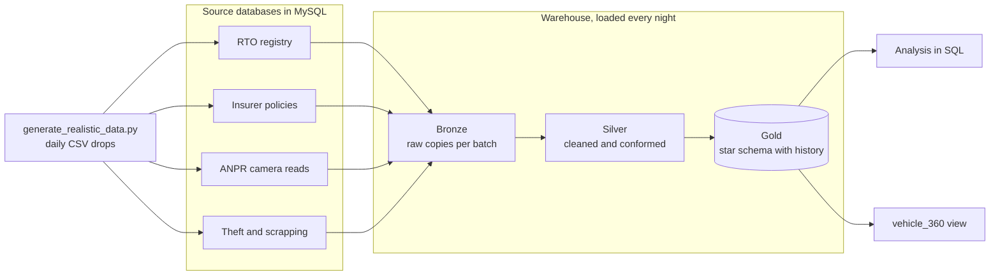

# Vehicle Compliance Platform

A data warehouse and ETL pipeline that turns raw records from four independently designed Indian vehicle data sources into analytics-ready tables:

- the RTO registry
- insurer policy feeds
- ANPR camera reads
- police theft FIRs and RVSF scrapping records

The warehouse is built to answer questions such as:

- Which states see the most uninsured vehicles on the road, month by month?
- How many two-wheelers lapse after their first policy?
- Where do stolen vehicles turn up?

On 4 August 2026, the Supreme Court directed that ANPR cameras be integrated with the IIB and VAHAN databases so that uninsured vehicles receive automatic e-challans ([report](https://www.thelawadvice.com/news/sc-orders-automatic-e-challans-for-uninsured-vehicles-directs-4-year-insurance-for-new-cars-6-years-for-two-wheelers)). That is the same integration this warehouse performs, aimed at analysis rather than enforcement.

## Architecture



The four sources have no foreign keys between them; the warehouse is the only place they meet. Each source gets a daily drop of new and changed records, and every night a pipeline extracts those changes, cleans them and loads them through three layers:

- **Bronze** keeps raw copies of every new or changed source row, tagged with a batch id.
- **Silver** cleans and conforms them: it parses plate numbers, gives each vehicle a single identity, works out insurance coverage periods and current theft status, and flags bad camera reads.
- **Gold** is a star schema of facts and dimensions that keeps history, so trends can be analysed. It is the source of truth for historical analysis.

Quality checks run after silver and after gold, and every run is logged. The design is in [docs/DATA_MODEL.md](docs/DATA_MODEL.md).

## What's built

1. **Design.** The grain of each fact, the star schema, the cleaning rules, naming conventions and a data catalog: [docs/DATA_MODEL.md](docs/DATA_MODEL.md).
2. **Bronze.** Incremental extraction from the four sources using their change-tracking columns (`ingested_at`, `issued_at`, `last_updated`, `updated_at`), with a watermark per source and a log of each batch.
3. **Silver.** Rebuilt from bronze on every run:
   - identify each vehicle by chassis number
   - parse every plate into one format
   - compute third-party coverage periods (own-damage-only policies don't count)
   - keep the current theft status
   - map insurer names (Reliance General → IndusInd)
   - deduplicate camera reads and flag misreads
4. **Gold.** The star schema, loaded incrementally:
   - `fact_sighting`, recording the status at the moment of each camera read
   - `fact_policy`
   - `fact_theft_case`
   - `fact_compliance_monthly`, a monthly compliance snapshot of every vehicle
   - date, state, location, insurer and vehicle dimensions; the vehicle dimension keeps every registry change (SCD type 2)
5. **Quality checks.** 23 checks after silver and after gold, recorded in the run log; a failed check after silver stops the night before gold changes ([section 11](docs/DATA_MODEL.md#11-quality-checks)).
6. **Nightly job.** One command, `scripts/run_nightly.sh`, run at 00:05 by launchd on a Mac (cron on Linux).

Future work: summary views (marts) for the common questions, and a dashboard on top of them.

## Quick start (macOS)

```bash
M="mysql --local-infile=1 -h 127.0.0.1 -u iia_app -piia_app_pw"   # used by every step below

# one-time setup
brew install mysql && brew services start mysql
python3 -m venv venv && source venv/bin/activate
pip install mysql-connector-python
mysql -u root -p < mysql/00_setup_mysql.sql            # the iia_app user and all databases
mysql -u root -p -e "SET PERSIST local_infile = 1;"   # allow LOAD DATA LOCAL
$M < mysql/etl/ddl_etl.sql                             # run log and watermarks
$M < mysql/bronze/ddl_bronze.sql                       # bronze tables
$M < mysql/silver/ddl_silver.sql                       # silver tables
$M < mysql/gold/ddl_gold.sql                           # gold tables and the vehicle_360 view

# 1. generate the data (~30 s; writes sources/ and daily/)
python3 generate_realistic_data.py

# 2. load the four source databases, up to the night of 3 Nov 2026
$M < mysql/01_create_source_tables.sql
$M < mysql/02_load_base.sql

# 3. run the pipeline for that night: bronze, silver and gold (~3 min the first time)
python3 run_pipeline.py --as-of 2026-11-03

# 4. the next three nights: load the day's drop, then run the pipeline again
for d in 04 05 06; do
  $M < mysql/03_load_daily_2026-11-$d.sql
  python3 run_pipeline.py --as-of 2026-11-$d || break
done
```

Each run copies the night's changes into bronze, rebuilds silver from bronze, and adds what is new to gold. The first run takes about 3 minutes because it fills 47 months of compliance history; later nights take under a minute. Every step is logged in `etl.batch` and `etl.step_log`. If a run fails, fix the cause and rerun the same command. Only one run can happen at a time.

A run ends by printing the share of vehicles without valid third-party cover. On 6 Nov 2026 it is 49.2% of registered vehicles and 29.2% of those seen on camera in the previous 90 days, the same figures `calibration_report.md` measures on the generated data.

23 quality checks run after silver and after gold. If one fails after silver, the night stops before gold changes; the usual fix is a parsing rule or a mapping in `ref/`, then the same command again. To see a night's checks:

```bash
$M -e "SELECT step, status, rows_affected, message FROM etl.step_log
        WHERE batch_id = (SELECT MAX(batch_id) FROM etl.batch) AND step LIKE 'check:%'"
```

`01_create_source_tables.sql` drops and recreates the four source tables. To rerun the whole sequence from scratch, also run `$M < mysql/etl/reset_warehouse.sql`, which empties the three layers and the run log; the pipeline refuses to run on recreated sources until you do. `mysql/04_sanity_checks.sql` gives a first look at the loaded sources.

## Using the warehouse

Gold is plain MySQL, so any SQL client can query it. Three examples, run with `$M` after the quick start:

```sql
-- Share of registered vehicles without valid third-party cover, month by month
SELECT d.month_label, ROUND(100 * AVG(m.is_uninsured), 1) AS pct_uninsured
FROM gold.fact_compliance_monthly m
JOIN gold.dim_date d ON d.date_key = m.month_key
WHERE m.status NOT IN ('STOLEN', 'SCRAPPED')
GROUP BY d.month_label
ORDER BY d.month_label;

-- States where cameras saw the most uninsured vehicles in October 2026
SELECT s.state_name, SUM(f.is_uninsured) AS uninsured_sightings,
       ROUND(100 * AVG(f.is_uninsured), 1) AS pct_of_sightings
FROM gold.fact_sighting f
JOIN gold.dim_state s ON s.state_key = f.state_key
JOIN gold.dim_date d ON d.date_key = f.date_key
WHERE f.read_status = 'MATCHED' AND d.month_label = '2026-10'
GROUP BY s.state_name
ORDER BY uninsured_sightings DESC
LIMIT 5;

-- Everything known about one plate: a two-wheeler reported stolen on 5 Nov and seen on camera on 6 Nov
SELECT * FROM gold.vehicle_360 WHERE plate = 'DL13SET1336';
```

Section 1 of [docs/DATA_MODEL.md](docs/DATA_MODEL.md) lists the questions the star schema is built for, and the fact table that answers each.

## Nightly schedule (optional)

The quick start runs each night by hand. `scripts/run_nightly.sh` is the one command a scheduler calls instead: it runs the pipeline for yesterday and appends to `logs/pipeline_YYYY-MM-DD.log` (kept for 30 days); on a Mac, a failed night also shows a notification. To schedule it on a Mac:

```bash
bash scripts/schedule_nightly.sh                                    # every night at 00:05
launchctl kickstart gui/$(id -u)/local.vehicle-compliance.nightly   # run it once now, to test
bash scripts/schedule_nightly.sh remove                             # stop the schedule
```

It uses launchd rather than cron because a MacBook is usually asleep at midnight: cron skips a run it misses, while launchd runs it as soon as the Mac wakes. macOS does not let scheduled jobs read `~/Desktop`, `~/Documents` or `~/Downloads`, so keep the repo somewhere else, such as `~/Projects`; the script checks this. On a Linux server, the same job is one cron line: `5 0 * * * /bin/bash /path/to/repo/scripts/run_nightly.sh`.

A missed night needs no special handling, because the next run copies everything since the watermarks.

## The data

Real per-vehicle registration and insurance records are not public in India, so the records are simulated. Every distribution is calibrated to a published figure, though, and the reference data is real: 701 NHAI toll plazas and the RTO codes of every state and union territory. [DATA_SOURCES.md](DATA_SOURCES.md) gives the source for every number and lists the assumptions; running the generator also writes `calibration_report.md`, which measures the fit.

| Measure | This dataset | Official figure |
|---|---:|---|
| Two-wheelers in the fleet | 73.4% | 74.7% (MoRTH, 2020) |
| Registered vehicles without valid third-party cover | 49.2% | 44% (VAHAN, Mar 2026) to ~54-56% (Supreme Court, Aug 2026) |
| Vehicles stolen per year | 0.067% | ~0.06% (NCRB 2024) |
| Two-wheeler share of thefts | 83.2% | 85.4% (NCRB 2017) |
| Stolen vehicles recovered | 23.5% | ~15-25% (city police data) |

What each source contains, at the default size of 100,000 vehicles:

- **`rto_registration.registrations`:** about 100k vehicles registered from 2008 to 2026, across 10 vehicle classes. Real RTO codes, BH-series plates, and the legacy AP/TS/TG and OR/OD codes.
- **`insurance.policies`:** about 137k policies from 25 insurers, in force since 2023. Includes renewals, lapses, long-term third-party cover (3 years for cars, 5 for two-wheelers) and own-damage-only policies.
- **`roadcapture.capture_log`:** about 459k reads over 12 months from toll plazas and city cameras, with OCR confidence scores and ingestion times.
- **`theft_records.theft_shredding`:** about 615 records: police theft FIRs, open or recovered, plus RVSF scrapping certificates.

The data deliberately contains the problems that make integration hard:

- the same plate written several ways
- policies filed under `NEW` before a plate exists
- several policies per vehicle
- camera misreads and unreadable plates
- thefts that were later recovered
- cloned plates of scrapped vehicles
- camera reads that arrive days late
- an insurer renamed partway through the feed

The generator is seeded, so `python3 generate_realistic_data.py` recreates byte-identical files in about 30 seconds. Use `--vehicles` to change the size.

## Repository layout

```
├── generate_realistic_data.py   calibrated data generator (standard library only, seeded)
├── ref/                         real reference data, the pipeline's mappings, and the scripts that built them
├── mysql/                       00 setup · 01 tables · 02 base load · 03 nightly loads · 04 sanity checks
│   ├── etl/                     run log and watermark tables, reset_warehouse.sql
│   ├── bronze/                  bronze tables
│   ├── silver/                  silver tables
│   └── gold/                    gold tables and the vehicle_360 view
├── run_pipeline.py              one night of the warehouse pipeline (--as-of YYYY-MM-DD)
├── pipeline/                    one module per layer, the quality checks, the plate parser, the run log
├── scripts/                     the nightly job, and the script that schedules it on a Mac
├── docs/DATA_MODEL.md           warehouse design: grain, star schema, rules, naming, catalog
├── db_config.py                 MySQL connection settings (local, throwaway credentials)
├── DATA_SOURCES.md              provenance and assumptions
└── sources/ daily/              generated locally, not committed (calibration_report.md and logs/ too)
```

Author: Akash Chakraborty, M.Tech CSE, IIIT-Delhi
