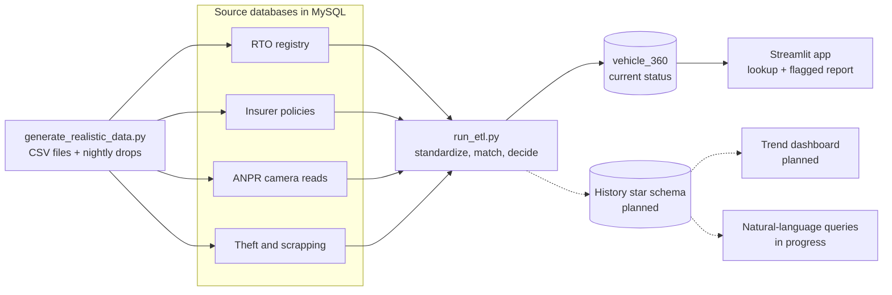

# Vehicle Compliance Platform

Is a vehicle seen on an Indian road insured, stolen, or clear? This project answers that question by integrating four independently designed data sources into a MySQL warehouse:

- the RTO registry
- insurer policy feeds
- ANPR camera reads
- police theft FIRs and RVSF scrapping records

It is being extended into an analytics platform for compliance trends.

It started as the Part A term project for CSE656 Information Integration and Applications at IIIT-Delhi ([original repository](https://github.com/cakash691/Identification-of-Uninsured-Vehicles)).

On 4 August 2026, the Supreme Court directed that ANPR cameras be integrated with the IIB and VAHAN databases so that uninsured vehicles receive automatic e-challans ([report](https://www.thelawadvice.com/news/sc-orders-automatic-e-challans-for-uninsured-vehicles-directs-4-year-insurance-for-new-cars-6-years-for-two-wheelers)). This project prototypes that integration.

## Architecture



The four sources have no foreign keys between them. The ETL is the only place they meet, and it does three things:

- standardizes plate numbers
- matches records across the sources
- applies severity-ordered rules: theft or scrapping, then no valid insurance, then clear

`vehicle_360` holds the current status of every vehicle seen on camera. History tables for analysis are next.

## Status

| Component | Status |
|---|---|
| Four source databases, loaded with calibrated data | Done |
| Bulk load and three nightly drops (`mysql/`) | Done |
| ETL (`run_etl.py`): incremental extract, standardize, decide, upsert | Working; accuracy fixes planned |
| `vehicle_360` and the Streamlit lookup app | Done |
| Accuracy scoring against ground truth (`evaluate_etl.py`) | Done |
| History star schema for analytics | Planned |
| Nightly scheduler | Planned |
| Trend dashboard | Planned |
| Natural-language queries (CSE656 Part C) | In progress |

## Quick start (macOS)

```bash
# one-time setup
brew install mysql && brew services start mysql
python3 -m venv venv && source venv/bin/activate
pip install mysql-connector-python pandas streamlit
mysql -u root -p < mysql/00_setup_mysql.sql            # 5 databases + the iia_app user
mysql -u root -p -e "SET PERSIST local_infile = 1;"   # allow LOAD DATA LOCAL

# 1. generate the data (~35 s; writes sources/, daily/, answer_key/)
python3 generate_realistic_data.py

# 2. load the four source databases
M="mysql --local-infile=1 -h 127.0.0.1 -u iia_app -piia_app_pw"
$M < mysql/01_create_source_tables.sql
$M < mysql/02_load_base.sql

# 3. integrate and explore
python3 run_etl.py
python3 check_connections.py
streamlit run app.py                                   # Ctrl+C to stop

# 4. nightly batches: load one day's drop, then rerun the ETL (it processes only new reads)
$M < mysql/03_load_daily_2026-11-04.sql && python3 run_etl.py
$M < mysql/03_load_daily_2026-11-05.sql && python3 run_etl.py
$M < mysql/03_load_daily_2026-11-06.sql && python3 run_etl.py

# 5. score the warehouse against the ground truth
python3 evaluate_etl.py
```

`01_create_source_tables.sql` drops and recreates the four source tables and resets the warehouse, so the whole sequence can be rerun from scratch. `mysql/04_sanity_checks.sql` gives a first look at the loaded data.

## The data

Real per-vehicle registration and insurance records are not public in India, so the records are simulated. Every distribution is calibrated to a published figure, though, and the reference data is real: 701 NHAI toll plazas and the RTO codes of every state and union territory. [DATA_SOURCES.md](DATA_SOURCES.md) gives the source for every number and lists the assumptions; [calibration_report.md](calibration_report.md) measures the fit.

| Measure | This dataset | Official figure |
|---|---:|---|
| Two-wheelers in the fleet | 73.4% | 74.7% (MoRTH, 2020) |
| Registered vehicles without valid third-party cover | 49.2% | 44% (VAHAN, Mar 2026) to ~54-56% (Supreme Court, Aug 2026) |
| Vehicles stolen per year | 0.067% | ~0.06% (NCRB 2024) |
| Two-wheeler share of thefts | 83.2% | 85.4% (NCRB 2017) |
| Stolen vehicles recovered | 23.5% | ~15-25% (city police data) |

What each source contains, at the default size of 100,000 vehicles:

- **`rto_registration.registrations`:** about 100k vehicles registered from 2008 to 2026, across 10 vehicle classes. Real RTO codes, BH-series plates, and the legacy AP/TS/TG and OR/OD codes.
- **`insurance.policies`:** about 137k policies from 25 insurers, in force since 2023. Includes renewals, lapses, long-term third-party cover (3 years for cars, 5 for two-wheelers) and own-damage-only policies.
- **`roadcapture.capture_log`:** about 459k reads over 12 months from toll plazas and city cameras, with OCR confidence scores and ingestion times.
- **`theft_records.theft_shredding`:** about 615 records: police theft FIRs, open or recovered, plus RVSF scrapping certificates.

The data deliberately contains the problems that make integration hard:

- the same plate written several ways
- policies filed under `NEW` before a plate exists
- several policies per vehicle
- camera misreads and unreadable plates
- thefts that were later recovered
- cloned plates of scrapped vehicles
- camera reads that arrive days late
- an insurer renamed partway through the feed

The generator is seeded, so `python3 generate_realistic_data.py` recreates byte-identical files in about 35 seconds. Use `--vehicles` to change the size.

## Measuring accuracy

Because the data is simulated, the true status of every vehicle is known (`answer_key/`). `evaluate_etl.py` scores `vehicle_360` against it. This is the baseline for the Part A ETL, measured by running the quick start above:

| Metric | Part A ETL |
|---|---|
| Status accuracy on real plates | 86.7% |
| Insured vehicles wrongly flagged | 19.6% (6,447 of 32,859) |
| Uninsured vehicles missed | 0 |
| Stolen or scrapped vehicles caught | 67 of 67, plus 80 false alarms on recovered cases |
| `vehicle_360` rows that are not real plates | 12,260 of 61,061 |

## Roadmap

1. **Fix ETL accuracy:**
   - match `NEW` policies on `chassis_no` (4,328 of the wrongful flags)
   - use the third-party policy valid on the date instead of the last row (1,485)
   - parse plates into their parts (562)
   - re-evaluate a vehicle's status when a policy arrives later (41)
   - ignore recovered thefts
   - watermark on `ingested_at`
   - handle camera misreads (CSE656 Part B)
2. **Add a history star schema:** `fact_sighting` with vehicle, date, location and insurer dimensions, so trends can be analysed.
3. **Schedule the nightly batch.**
4. **Build on the history tables:** a trend dashboard and natural-language queries (CSE656 Part C).

## Repository layout

```
├── generate_realistic_data.py   calibrated data generator (standard library only, seeded)
├── ref/                         real reference data + the scripts that built it
├── mysql/                       00 setup · 01 tables · 02 base load · 03 nightly loads · 04 checks
├── run_etl.py                   extract → standardize → decide → upsert into vehicle_360
├── app.py                       Streamlit lookup and flagged-vehicle report
├── db_config.py                 MySQL connection settings (local, throwaway credentials)
├── check_connections.py         verifies all five databases are reachable
├── evaluate_etl.py              scores vehicle_360 against the answer key
├── .streamlit/config.toml       app theme
├── DATA_SOURCES.md              provenance and assumptions
├── calibration_report.md        simulated vs official figures
└── sources/ daily/ answer_key/  generated locally, not committed
```

Author: Akash Chakraborty, M.Tech CSE, IIIT-Delhi
