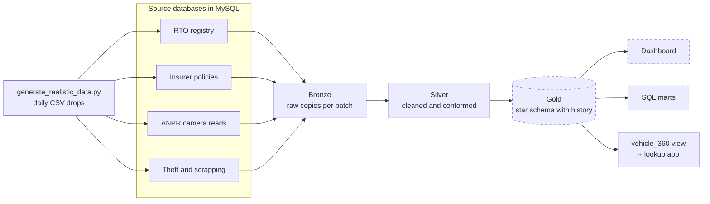

# Vehicle Compliance Platform

A data warehouse and ETL pipeline that turns raw records from four independently designed Indian vehicle data sources into analytics-ready tables:

- the RTO registry
- insurer policy feeds
- ANPR camera reads
- police theft FIRs and RVSF scrapping records

The warehouse is built to answer questions such as:

- Which states see the most uninsured vehicles on the road, month by month?
- How many two-wheelers lapse after their first policy?
- Where do stolen vehicles turn up?

On 4 August 2026, the Supreme Court directed that ANPR cameras be integrated with the IIB and VAHAN databases so that uninsured vehicles receive automatic e-challans ([report](https://www.thelawadvice.com/news/sc-orders-automatic-e-challans-for-uninsured-vehicles-directs-4-year-insurance-for-new-cars-6-years-for-two-wheelers)). That is the same integration this warehouse performs, aimed at analysis rather than enforcement. An earlier prototype lives in [Identification-of-Uninsured-Vehicles](https://github.com/cakash691/Identification-of-Uninsured-Vehicles).

## Architecture



The four sources have no foreign keys between them; the warehouse is the only place they meet. It is organised in three layers:

- **Bronze** keeps raw copies of every new or changed source row, tagged with a batch id.
- **Silver** cleans and conforms them: it parses plate numbers, gives each vehicle a single identity, works out insurance coverage periods and current theft status, and flags bad camera reads.
- **Gold** is a star schema of facts and dimensions that keeps history, so trends can be analysed.

Bronze and silver are built; dashed boxes are planned. Until gold exists, a prototype ETL (`run_etl.py`) still builds `vehicle_360` straight from the sources. It will be rebuilt on top of the gold layer. The design for all three layers is in [docs/DATA_MODEL.md](docs/DATA_MODEL.md).

## Status

| Component | Status |
|---|---|
| Four source databases, loaded with calibrated data | Done |
| Bulk load and three nightly drops (`mysql/`) | Done |
| Accuracy scoring against ground truth (`evaluate_etl.py`) | Done |
| Prototype ETL (`run_etl.py`) → `vehicle_360` + Streamlit lookup app | Done; to be rebuilt on the warehouse layers |
| Warehouse design (`docs/DATA_MODEL.md`) | Done |
| Bronze layer: raw copies per batch, with a run log and watermarks (`run_pipeline.py`) | Done |
| Silver layer: cleaned and conformed, rebuilt from bronze on every run | Done |
| Gold layer: star schema with history | Next |
| Data quality tests | Planned |
| Nightly orchestration | Planned |
| SQL marts and analytics dashboard | Planned |

## Quick start (macOS)

```bash
M="mysql --local-infile=1 -h 127.0.0.1 -u iia_app -piia_app_pw"   # used by every step below

# one-time setup
brew install mysql && brew services start mysql
python3 -m venv venv && source venv/bin/activate
pip install mysql-connector-python pandas streamlit
mysql -u root -p < mysql/00_setup_mysql.sql            # the iia_app user and all databases
mysql -u root -p -e "SET PERSIST local_infile = 1;"   # allow LOAD DATA LOCAL
$M < mysql/etl/ddl_etl.sql                             # run log and watermarks
$M < mysql/bronze/ddl_bronze.sql                       # bronze tables
$M < mysql/silver/ddl_silver.sql                       # silver tables

# 1. generate the data (~35 s; writes sources/, daily/, answer_key/)
python3 generate_realistic_data.py

# 2. load the four source databases, up to the night of 3 Nov 2026
$M < mysql/01_create_source_tables.sql
$M < mysql/02_load_base.sql

# 3. run that night: the warehouse pipeline, then the prototype ETL
python3 run_pipeline.py --as-of 2026-11-03             # fills bronze, then builds silver
python3 run_etl.py                                     # prototype: builds vehicle_360

# 4. the next three nights: load the day's drop, then run both again
for d in 04 05 06; do
  $M < mysql/03_load_daily_2026-11-$d.sql
  python3 run_pipeline.py --as-of 2026-11-$d && python3 run_etl.py
done

# 5. explore the prototype and score it against the ground truth
python3 check_connections.py
streamlit run app.py                                   # Ctrl+C to stop
python3 evaluate_etl.py
```

Each pipeline run copies only the new changes into bronze, then rebuilds silver from bronze (about 30 seconds in all), and logs every step in `etl.batch` and `etl.step_log`. If a run fails, fix the cause and rerun the same command.

`01_create_source_tables.sql` drops and recreates the four source tables and the prototype's `vehicle_360`. To rerun the whole sequence from scratch, also run `$M < mysql/etl/reset_warehouse.sql`, which empties bronze and the run log; the pipeline refuses to run on recreated sources until you do. `mysql/04_sanity_checks.sql` gives a first look at the loaded data.

## The data

Real per-vehicle registration and insurance records are not public in India, so the records are simulated. Every distribution is calibrated to a published figure, though, and the reference data is real: 701 NHAI toll plazas and the RTO codes of every state and union territory. [DATA_SOURCES.md](DATA_SOURCES.md) gives the source for every number and lists the assumptions; [calibration_report.md](calibration_report.md) measures the fit.

| Measure | This dataset | Official figure |
|---|---:|---|
| Two-wheelers in the fleet | 73.4% | 74.7% (MoRTH, 2020) |
| Registered vehicles without valid third-party cover | 49.2% | 44% (VAHAN, Mar 2026) to ~54-56% (Supreme Court, Aug 2026) |
| Vehicles stolen per year | 0.067% | ~0.06% (NCRB 2024) |
| Two-wheeler share of thefts | 83.2% | 85.4% (NCRB 2017) |
| Stolen vehicles recovered | 23.5% | ~15-25% (city police data) |

What each source contains, at the default size of 100,000 vehicles:

- **`rto_registration.registrations`:** about 100k vehicles registered from 2008 to 2026, across 10 vehicle classes. Real RTO codes, BH-series plates, and the legacy AP/TS/TG and OR/OD codes.
- **`insurance.policies`:** about 137k policies from 25 insurers, in force since 2023. Includes renewals, lapses, long-term third-party cover (3 years for cars, 5 for two-wheelers) and own-damage-only policies.
- **`roadcapture.capture_log`:** about 459k reads over 12 months from toll plazas and city cameras, with OCR confidence scores and ingestion times.
- **`theft_records.theft_shredding`:** about 615 records: police theft FIRs, open or recovered, plus RVSF scrapping certificates.

The data deliberately contains the problems that make integration hard:

- the same plate written several ways
- policies filed under `NEW` before a plate exists
- several policies per vehicle
- camera misreads and unreadable plates
- thefts that were later recovered
- cloned plates of scrapped vehicles
- camera reads that arrive days late
- an insurer renamed partway through the feed

The generator is seeded, so `python3 generate_realistic_data.py` recreates byte-identical files in about 35 seconds. Use `--vehicles` to change the size.

## Measuring accuracy

Because the data is simulated, the true status of every vehicle is known (`answer_key/`). `evaluate_etl.py` scores `vehicle_360` against it. This is the baseline for the prototype ETL, measured by running the quick start above:

| Metric | Prototype ETL |
|---|---|
| Status accuracy on real plates | 86.7% |
| Insured vehicles wrongly flagged | 19.6% (6,447 of 32,859) |
| Uninsured vehicles missed | 0 |
| Stolen or scrapped vehicles caught | 67 of 67, plus 80 false alarms on recovered cases |
| `vehicle_360` rows that are not real plates | 12,260 of 61,061 |

## Roadmap

1. **Design** (done). Define the grain of each fact, the star schema, naming conventions and a data catalog: [docs/DATA_MODEL.md](docs/DATA_MODEL.md).
2. **Bronze** (done). Extract incrementally from the four sources using their change-tracking columns (`ingested_at`, `issued_at`, `last_updated`, `updated_at`), and log each batch.
3. **Silver** (done). Clean and conform the sources, removing the causes of the prototype's 6,447 wrongful flags:
   - identify each vehicle by chassis number
   - parse every plate into one format
   - compute third-party coverage periods (own-damage-only policies don't count)
   - keep the current theft status
   - map insurer names (Reliance General → IndusInd)
   - deduplicate camera reads and flag misreads
4. **Gold.** Build the star schema:
   - `fact_sighting`, recording the status at the moment of each camera read
   - `fact_policy`
   - `fact_theft_case`
   - a monthly compliance snapshot
   - date, state, vehicle (with history), location and insurer dimensions, with stable surrogate keys
5. **Quality tests** that stop a bad batch before it reaches gold, recorded in the run log.
6. **Nightly orchestration:** one command, scheduled with cron.
7. **Analytics:** SQL marts and a dashboard, with `vehicle_360` rebuilt as a gold view for the lookup app.

## Repository layout

```
├── generate_realistic_data.py   calibrated data generator (standard library only, seeded)
├── ref/                         real reference data, the pipeline's mappings, and the scripts that built them
├── mysql/                       00 setup · 01 tables · 02 base load · 03 nightly loads · 04 checks
│   ├── etl/                     run log and watermark tables, reset_warehouse.sql
│   ├── bronze/                  bronze tables
│   └── silver/                  silver tables
├── run_pipeline.py              one night of the warehouse pipeline (--as-of YYYY-MM-DD)
├── pipeline/                    one module per layer (bronze and silver so far), the plate parser, the run log
├── docs/DATA_MODEL.md           warehouse design: grain, star schema, rules, naming, catalog
├── run_etl.py                   prototype: extract → standardize → decide → upsert into vehicle_360
├── app.py                       Streamlit lookup and flagged-vehicle report
├── db_config.py                 MySQL connection settings (local, throwaway credentials)
├── check_connections.py         verifies every database is reachable
├── evaluate_etl.py              scores vehicle_360 against the answer key
├── .streamlit/config.toml       app theme
├── DATA_SOURCES.md              provenance and assumptions
├── calibration_report.md        simulated vs official figures
└── sources/ daily/ answer_key/  generated locally, not committed
```

Author: Akash Chakraborty, M.Tech CSE, IIIT-Delhi
