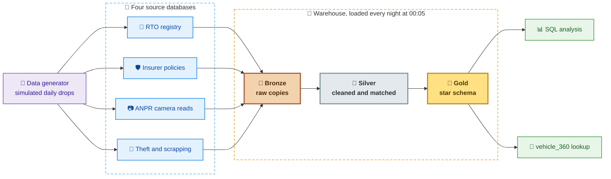

# Vehicle Compliance Platform

A data warehouse and nightly ETL pipeline built with Python and MySQL. It combines four independent vehicle data sources (the RTO registry, insurer policies, ANPR camera reads and police theft records), cleans the data, and loads it into a star schema for historical analysis: for example, which states have the most uninsured vehicles on the road, month by month.

## Architecture



- **Bronze** keeps a raw copy of every new or changed source row, tagged with the night that copied it. The sources overwrite their rows; bronze keeps every version.
- **Silver** cleans and matches the data: one plate format, every record tied to a vehicle by its chassis number, and bad camera reads flagged.
- **Gold** is the star schema that gets queried: 5 dimension tables and 4 fact tables, including a monthly snapshot of every vehicle's status. It keeps each vehicle's history (SCD Type 2).

Each night copies only what changed since the last run, using a watermark per source. 23 data-quality checks run after silver and after gold; if a check after silver fails, gold is not touched. Every run is logged in the `etl` database. The design is in [docs/DATA_MODEL.md](docs/DATA_MODEL.md).

## Quick start (macOS)

```bash
M="mysql --local-infile=1 -h 127.0.0.1 -u iia_app -piia_app_pw"   # used by every step below

# one-time setup
brew install mysql && brew services start mysql
python3 -m venv venv && source venv/bin/activate
pip install mysql-connector-python
mysql -u root -p < mysql/00_setup_mysql.sql            # the iia_app user and all databases
mysql -u root -p -e "SET PERSIST local_infile = 1;"   # allow LOAD DATA LOCAL
$M < mysql/etl/ddl_etl.sql                             # run log and watermarks
$M < mysql/bronze/ddl_bronze.sql                       # bronze tables
$M < mysql/silver/ddl_silver.sql                       # silver tables
$M < mysql/gold/ddl_gold.sql                           # gold tables and the vehicle_360 view

# 1. generate the data (~30 s; writes sources/ and daily/)
python3 generate_realistic_data.py

# 2. load the four source databases, up to the night of 3 Nov 2026
$M < mysql/01_create_source_tables.sql
$M < mysql/02_load_base.sql

# 3. run the pipeline for that night (~3 min the first time)
python3 run_pipeline.py --as-of 2026-11-03

# 4. the next three nights: load the day's changes, then run the pipeline
for d in 04 05 06; do
  $M < mysql/03_load_daily_2026-11-$d.sql
  python3 run_pipeline.py --as-of 2026-11-$d || break
done
```

Later nights take under a minute. Each run ends by printing the share of vehicles without valid third-party cover (49.2% on 6 Nov 2026). If a run fails, fix the cause and run the same command again; only one run can happen at a time. To see the last night's checks:

```bash
$M -e "SELECT step, status, rows_affected, message FROM etl.step_log
        WHERE batch_id = (SELECT MAX(batch_id) FROM etl.batch) AND step LIKE 'check:%'"
```

To start over, run `$M < mysql/etl/reset_warehouse.sql`, which empties the warehouse, and repeat from step 2.

## Example queries

```sql
-- Share of registered vehicles without valid third-party cover, month by month
SELECT d.month_label, ROUND(100 * AVG(m.is_uninsured), 1) AS pct_uninsured
FROM gold.fact_compliance_monthly m
JOIN gold.dim_date d ON d.date_key = m.month_key
WHERE m.status NOT IN ('STOLEN', 'SCRAPPED')
GROUP BY d.month_label
ORDER BY d.month_label;

-- States where cameras saw the most uninsured vehicles in October 2026
SELECT s.state_name, SUM(f.is_uninsured) AS uninsured_sightings,
       ROUND(100 * AVG(f.is_uninsured), 1) AS pct_of_sightings
FROM gold.fact_sighting f
JOIN gold.dim_state s ON s.state_key = f.state_key
JOIN gold.dim_date d ON d.date_key = f.date_key
WHERE f.read_status = 'MATCHED' AND d.month_label = '2026-10'
GROUP BY s.state_name
ORDER BY uninsured_sightings DESC
LIMIT 5;

-- Everything known about one plate: a two-wheeler reported stolen on 5 Nov and seen on camera on 6 Nov
SELECT * FROM gold.vehicle_360 WHERE plate = 'DL13SET1336';
```

## Nightly schedule (optional)

`scripts/run_nightly.sh` runs the pipeline for the previous day and writes a log to `logs/`. On a Mac, schedule it with launchd:

```bash
bash scripts/schedule_nightly.sh          # every night at 00:05
bash scripts/schedule_nightly.sh remove   # stop
```

launchd is used instead of cron because a Mac is usually asleep at midnight: launchd runs a missed job when the Mac wakes, while cron skips it. macOS doesn't let scheduled jobs read `~/Desktop`, `~/Documents` or `~/Downloads`, so keep the repo somewhere else. On Linux, use cron: `5 0 * * * /bin/bash /path/to/repo/scripts/run_nightly.sh`.

## The data

Real per-vehicle registration and insurance records are not public, so the data is simulated by a seeded generator. Its main figures are set to match published ones (for example, 73.4% of vehicles are two-wheelers, against 74.7% in MoRTH data), and the reference data is real: 701 NHAI toll plazas and the RTO codes of every state. [DATA_SOURCES.md](DATA_SOURCES.md) lists the sources and assumptions, and running the generator also writes `calibration_report.md`.

| Source table | Rows | Contents |
|---|---:|---|
| `rto_registration.registrations` | 100,000 | Vehicles registered from 2008 to 2026; current state only |
| `insurance.policies` | ~137,000 | Policies in force since 2023, from 25 insurers |
| `roadcapture.capture_log` | ~459,000 | 12 months of reads from toll plazas and city cameras |
| `theft_records.theft_shredding` | 616 | Police theft reports and scrapping certificates |

The data includes the usual integration problems: plates written several ways, policies filed before a plate exists, camera misreads and late-arriving reads, recovered thefts, and an insurer renamed partway through.

## Repository layout

```
├── generate_realistic_data.py   data generator (standard library only, seeded)
├── ref/                         reference data and mappings, and the scripts that built them
├── mysql/                       00 setup · 01 tables · 02 base load · 03 daily loads · 04 sanity checks
│   ├── etl/                     run log and watermark tables, reset_warehouse.sql
│   ├── bronze/                  bronze tables
│   ├── silver/                  silver tables
│   └── gold/                    gold tables and the vehicle_360 view
├── run_pipeline.py              runs one night of the pipeline (--as-of YYYY-MM-DD)
├── pipeline/                    one module per layer, the quality checks, the plate parser, the run log
├── scripts/                     the nightly job, and the script that schedules it on a Mac
├── docs/DATA_MODEL.md           warehouse design
├── db_config.py                 MySQL connection settings (local, throwaway credentials)
├── DATA_SOURCES.md              where the figures come from, and the assumptions
└── sources/ daily/              generated locally, not committed (nor are calibration_report.md and logs/)
```

Not built yet: summary views (marts) and a dashboard. The gold tables are designed to be queried directly.

Author: Akash Chakraborty, M.Tech CSE, IIIT-Delhi
