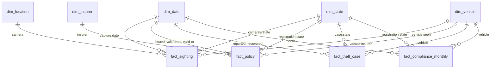

# Data model

Status, 7 Nov 2026: bronze, silver, gold, the quality checks and the run log are built. Nightly scheduling and the marts come next. Until the choices in section 12 are settled, the defaults described there apply.

This document fixes the design before any warehouse SQL is written: the questions the warehouse must answer, what one row means in each table, how keys and history work, the cleaning rules, the naming conventions, and a column-level catalog of the gold layer.

## 1. Questions the warehouse answers

| # | Question | Answered from | Planned view |
|---|---|---|---|
| Q1 | What share of registered vehicles in each state has no valid third-party cover, month by month? | `fact_compliance_monthly` | `mart_uninsured_by_state_month` |
| Q2 | How does that compare with the vehicles actually seen on the road? | `fact_compliance_monthly` | `mart_uninsured_by_state_month` |
| Q3 | Which toll plazas and city junctions see the most uninsured traffic? | `fact_sighting` | `mart_uninsured_by_location` |
| Q4 | How many owners renew on time, and how long do lapses last, by vehicle type? | `fact_policy` | `mart_renewal_gaps` |
| Q5 | How many vehicles are stolen per state each year, how many are recovered, and how fast? | `fact_theft_case` | `mart_theft_recovery` |
| Q6 | Which insurers issue the most policies by state, vehicle type and year, with merged companies combined? | `fact_policy` | `mart_insurer_share` |

The lookup app moves onto the warehouse through one more view, `vehicle_360` (section 9).

## 2. Layers

| Layer | MySQL database | What it holds | Each night |
|---|---|---|---|
| Sources | `rto_registration`, `insurance`, `roadcapture`, `theft_records` | The four operational databases (already built) | A daily drop is loaded |
| Bronze | `bronze` | Exact copies of source rows, plus `dwh_batch_id` and `dwh_loaded_at`. Append-only, so every version of a changed row is kept | Appends the rows past each source's watermark |
| Silver | `silver` | One clean row per real-world record: one plate format, vehicles identified by chassis number, bad and duplicate camera reads flagged. Also the `ref/` files as `ref_*` tables | Rebuilt in full from bronze (about 25 seconds at this size), so a fixed rule reaches all of history |
| Gold | `gold` | Star schema (5 dimensions, 4 facts) and the views built on it | See section 4 |
| Control | `etl` | Run log and watermarks | One row per run and per step |

Every run has a business date, `as_of`: the last day it covers. It defaults to yesterday, must be a finished day, and cannot go back before the last successful run. To replay the simulated nights, load the base files and run with `--as-of 2026-11-03`, then load each daily drop and run with that drop's date. Loading all the drops first also works, because each run takes only its own day.

Bronze copies the rows whose watermark column is later than the stored watermark (the newest value copied so far) and no later than the end of the run's `as_of` day:

| Source table | Watermark column | Note |
|---|---|---|
| `rto_registration.registrations` | `last_updated` (date) | Runs only copy finished days, so a date is precise enough: by the time a day is copied, all its changes are in |
| `insurance.policies` | `issued_at` | |
| `theft_records.theft_shredding` | `updated_at` (date) | As for registrations |
| `roadcapture.capture_log` | `ingested_at` | Not `capture_time`: 1% of reads arrive more than 24 hours late, and a `capture_time` watermark (the prototype's) skips them |

## 3. Star schema

Which dimensions each fact uses, and in what role:

| Fact | `dim_date` | `dim_state` | `dim_location` | `dim_vehicle` | `dim_insurer` |
|---|---|---|---|---|---|
| `fact_sighting` | capture date | where the camera is | camera | vehicle seen | |
| `fact_policy` | issued, valid from, valid to | registration state | | vehicle insured | insurer |
| `fact_theft_case` | reported, recovered | where the case was filed | | vehicle | |
| `fact_compliance_monthly` | month | registration state | | vehicle | |

`dim_date` plays several roles, and all four facts share `dim_state`, so every state-level question is a single join.

## 4. Grain

| Fact | One row per | Kind | Rows now | Each night |
|---|---|---|---|---|
| `fact_sighting` | camera read, without duplicate lane reads | transaction | ~458,000 | Inserts the new reads (~1,500) |
| `fact_policy` | policy | transaction | ~137,000 | Inserts the new policies (~80), and retries any whose vehicle was not registered yet |
| `fact_theft_case` | theft or scrapping case | accumulating snapshot: the row is updated as the case moves | 616 | Rewrites every case (there are few), so status, recovery and sightings stay current |
| `fact_compliance_monthly` | vehicle per calendar month, from January 2023 | periodic snapshot | ~3.9 million | Deletes and rebuilds the current and previous month (~200,000 rows); older months are final |

"Rows now" means after the base load and the three daily drops.

## 5. Keys and history

- **Surrogate keys.** Each dimension has an integer key named `<dimension>_key`, for example `vehicle_key`. Facts store these keys, not plates or names.
- **Date keys** are integers in `YYYYMMDD` form (`20261106`), so they are readable without a join.
- **Unknown members.** Every dimension has a row with key `-1` ("Unknown" or "Not yet"). A camera read that matches no vehicle gets `vehicle_key = -1`; an open theft case gets `recovery_date_key = -1`. Fact keys are never NULL, so inner joins never drop rows. The key is `-1` rather than `0` because MySQL treats an inserted `0` in an `AUTO_INCREMENT` column as "generate the next id".
- **Natural keys** keep their source names: `chassis_no`, `camera_id`, `policy_id`, `case_id`, `capture_id`. Facts use their source id as the primary key (the monthly snapshot uses `month_key` plus `vehicle_key`), so re-running a night cannot insert a row twice.
- **Vehicle history (SCD type 2).** `dim_vehicle` keeps one row per version of a vehicle, identified by `chassis_no`.
  - A new version starts whenever the registry records a change to the vehicle: in this data, ownership transfers, registration renewals and scrapping. `chassis_no` plus the registry's `last_updated` identifies a version. (A stricter design would overwrite corrections to fixed details, such as a misspelt model, instead of versioning them; this registry never sends any.)
  - `valid_from` and `valid_to` bound each version. The current one has `valid_to = 9999-12-31` and `is_current = 1`. A new version starts on the registry's `last_updated` date, and the previous one ends the day before.
  - The first version starts on `1900-01-01`, not on the load date, so events from before the warehouse existed (a policy bought days before registration, a sighting last year) still find a version. Its registry status counts only from its `last_updated` date, so a vehicle already scrapped at the first load is not treated as scrapped for all of its past.
  - History starts with the warehouse. The registry keeps only the current row, so changes made before the first load cannot be recovered. From then on, bronze keeps every changed row and `dim_vehicle` keeps every version. The three daily drops contain 10 such changes, all ownership transfers.
- **Point in time.** Each fact points at the vehicle version that was valid on the fact's own date: the capture date, the issue date, the report date, or the snapshot's `status_as_of`.
- **Indexes.** Each fact is indexed on its dimension keys; `dim_vehicle` on `(chassis_no, valid_from)` and `(plate, valid_from)`.
- **No enforced foreign keys** in gold. Loads stay simple and fast, and the quality checks (section 11) make sure every key resolves.

## 6. Cleaning rules (silver)

The prototype matched policies by plate and kept only the last policy per plate, so `NEW` filings, the insurers' different plate formats and `Standalone OD` policies all produced false flags (6,447 insured vehicles flagged). Rules 1 to 3 remove those causes.

1. **One plate format.** Uppercase the plate and drop spaces and hyphens, then parse it as one of three patterns:
   - standard: state code, RTO number padded to two digits, one or two series letters, four digits. `MH-4-AB-1234` becomes `MH04AB1234`
   - Delhi: RTO number without a leading zero, then the class letter and series. `DL-06-SCP-2349` becomes `DL6SCP2349`
   - BH series: `22 BH 1234 AA` becomes `22BH1234AA`

   Anything else is `INVALID_FORMAT`. On this data the rule turns every registry plate into the answer key's plate, and 99.6% of insurer plates into the registry plate of the same chassis. The rest are typos.
2. **Vehicles are identified by chassis number, not plate.** Every policy carries the chassis, including the 13,584 filed under `NEW`. About 10% of theft cases have no chassis, so those fall back to the plate. Camera reads have only a plate, so they are matched through the registry.
3. **Third-party cover.** Every policy type includes third-party (TP) cover except `Standalone OD`. The TP cover runs from `valid_from` to `valid_to`. For bundled policies, `valid_to` is the end of the TP term and `od_valid_to` the end of the one-year own-damage cover.
4. **Insurer names** map through `ref/insurers.csv`. `Bharti AXA General Insurance` maps to `ICICI Lombard` (merged 8 Sep 2021), `Reliance General` to `IndusInd General Insurance` (renamed 22 Sep 2025), and New India, United India, Oriental and National are public sector.
5. **Camera reads.** A second read of the same plate by the same camera within 5 seconds is an adjacent-lane duplicate: silver flags it and gold leaves it out. Each read gets a `read_status`: `UNREADABLE` (empty plate), `INVALID_FORMAT`, `NOT_IN_REGISTRY` (valid format but unknown: a misread or a fake plate) or `MATCHED`. Today 96.9% of reads match.
6. **Scrapping.** A vehicle counts as scrapped from the date of its certificate from a registered vehicle scrapping facility (RVSF), which the feed records as a `SHREDDED` case. Without a certificate, it counts as scrapped from the day the registry recorded it, which is later, or never.
7. **Theft.** A vehicle counts as stolen from the report date up to, but not including, the recovery date. Recovered vehicles are no longer flagged; the prototype flagged 80 of them.
8. **Status on a date.** One rule for every fact; the first match wins:

   | Status | When |
   |---|---|
   | `STOLEN` | a theft case is open on that date |
   | `SCRAPPED` | scrapped on or before that date |
   | `INSURED` | a policy with TP cover covers that date |
   | `EXPIRED` | the vehicle had TP cover in the insurer feed, but it has ended |
   | `NO_POLICY` | no TP cover in the feed at all (the feed starts on 1 Jan 2023) |

   `EXPIRED` and `NO_POLICY` together count as uninsured (`is_uninsured = 1`).

## 7. Bronze, silver and control tables

**Bronze** has one table per source table, with the same name and columns plus `dwh_batch_id` and `dwh_loaded_at`. Its primary key is the source id plus `dwh_batch_id`, because a changed row arrives again in a later batch. After the three daily drops, bronze holds 100,010 registration rows for 100,000 vehicles: the 10 ownership transfers are kept as second versions, while the registry itself has only the new owners.

**Silver**:

| Table | Key | Adds to the source columns |
|---|---|---|
| `plate_lookup` | `raw_plate` | Every distinct plate string in bronze (171,785 after the three drops), with its canonical `plate` and `plate_format`. Python parses each string once (`pipeline/plates.py`), so the SQL can simply join on it |
| `registrations` | `chassis_no`, `last_updated` | `plate` (canonical), `vehicle_group` (2W, CAR, TAXI, LCV, TRUCK, BUS, 3W_P, 3W_G, ERICK or TRACTOR, from `ref/vehicle_classes.csv`) and `is_current`. One row per version of a vehicle, so the 10 ownership transfers give 10 extra rows; gold builds `dim_vehicle`'s history from them |
| `policies` | `policy_id` | `plate` (NULL for `NEW`), `has_tp_cover`, `filed_under_new` |
| `theft_shredding` | `case_id` | `plate`, `chassis_no` filled from the registry when missing (`chassis_from_plate` = 1), `case_type` (`STOLEN` or `SCRAPPED`). Latest row per case |
| `capture_log` | `capture_id` | `plate`, `read_status`, the matched vehicle's `chassis_no`, `is_duplicate` |
| `ref_states`, `ref_rto_offices`, `ref_toll_plazas`, `ref_city_cameras`, `ref_insurers`, `ref_vehicle_classes` | their codes | Loaded as they are from `ref/`, which is already clean |

Each silver row carries `dwh_batch_id`, the bronze batch it came from, so gold can tell what is new since its last run.

**Control** (database `etl`):

| Table | One row per | Columns |
|---|---|---|
| `batch` | nightly run | `batch_id`, `as_of`, `started_at`, `finished_at`, `status` (`RUNNING`, `SUCCESS` or `FAILED`), `message` |
| `step_log` | step or quality check in a run | `step_id`, `batch_id`, `step`, `rows_affected`, `status` (`RUNNING`, `OK`, `FAILED`, `WARN`, or `ROLLED_BACK` when a later failure undid it), `message` (a check's note), `started_at`, `finished_at` |
| `watermark` | source table | `source_table`, `watermark_column`, `watermark_value`, `batch_id` |

## 8. Nightly order

1. Open a batch in `etl.batch` with its `as_of` date.
2. Bronze: copy the four sources past their watermarks, up to the end of `as_of`. The copies and the new watermarks are committed together, so a failed copy changes nothing.
3. Silver, rebuilt in full from bronze: the `ref_*` tables and the plate lookup, then registrations, policies, theft cases and camera reads. Registrations go first, so a vehicle registered today matches today's reads.
4. Quality checks on silver (section 11). An ERROR stops the batch here, before gold changes.
5. Gold: the dimensions (`dim_date` once, then `dim_state`, `dim_location`, `dim_insurer` and `dim_vehicle`), then `fact_policy`, `fact_sighting`, `fact_theft_case` and `fact_compliance_monthly`. Policies and camera reads that matched no vehicle on an earlier night are tried again. Each step commits as one transaction.
6. Quality checks on gold, then close the batch as `SUCCESS` or `FAILED`. Silver is rebuilt on every run, and gold adds only what it does not have yet (matched on source ids), so a failed night is simply run again. A MySQL named lock allows one run at a time, and a batch left `RUNNING` by a run that died is marked `FAILED` by the next one.

`dim_date` is generated once (2008 to 2030) and is not part of the nightly run.

## 9. Views

- The `mart_*` views from section 1, for the dashboard and EDA.
- `vehicle_360` (built with gold): one row per vehicle seen on camera, with its latest sighting, latest third-party policy and status on the latest `as_of`. It keeps the prototype table's columns and status wording, so `python3 evaluate_etl.py --database gold` scores the warehouse. In step 7 `app.py` reads it too, and the prototype's `run_etl.py` and `vehicle_dwh` database are retired.

## 10. Naming conventions

- MySQL calls a schema a database. The layers are the databases `bronze`, `silver`, `gold` and `etl`; the source databases keep their names. `mysql/00_setup_mysql.sql` gets a `CREATE DATABASE` and a `GRANT` line for each.
- Names are lowercase English `snake_case` and never MySQL reserved words. `reads` already caused one bug here; `rank`, `groups`, `last_value` and `year_month` are others to avoid.
- Bronze and silver tables keep the source table's name. Reference tables are `ref_<file name>`.
- Gold tables are `dim_<entity>` and `fact_<process>`, in the singular. Views are `mart_<topic>`.
- Keys: `<dimension>_key` for surrogate keys, `<role>_date_key` for dates (`report_date_key`), and `-1` for unknown.
- Flags start with `is_` or `has_` and hold 0 or 1. Counts and durations name their unit: `cover_days`, `vehicle_age_years`, `sightings_in_month`.
- Technical columns start with `dwh_`: `dwh_batch_id`, `dwh_loaded_at`.
- Code values are uppercase: `INSURED`, `TOLL_ANPR`, `MATCHED`.
- Files: DDL in `mysql/etl/`, `mysql/bronze/`, `mysql/silver/` and `mysql/gold/`; Python in `pipeline/load_bronze.py`, `pipeline/load_silver.py` and `pipeline/load_gold.py`, run in that order by `run_pipeline.py`, with the checks in `pipeline/checks.py`, the run log in `pipeline/runlog.py` and the plate parser in `pipeline/plates.py`. Mappings live in `ref/` as CSV files, not in code.

## 11. Quality checks

`pipeline/checks.py` runs these every night. Each is one SQL query that counts the rows breaking a rule, and each result goes to `etl.step_log` as a step named `check: ...`, with the count and a short note. After silver, an ERROR check is a gate: if it fails, the night stops before gold changes. After gold, an ERROR check is an alarm: it marks the batch `FAILED` so someone looks. A WARN is logged and the night carries on. Primary keys are not checked, because MySQL enforces them.

| After | Level | Check |
|---|---|---|
| silver | ERROR | registry: one current version per vehicle |
| silver | ERROR | registry: no two vehicles share a plate |
| silver | ERROR | registry: every plate parses |
| silver | ERROR | registry: every vehicle class is in `ref/vehicle_classes.csv` |
| silver | ERROR | policies: cover ends on or after it starts |
| silver | WARN | policies: every insurer is in `ref/insurers.csv` |
| silver | WARN | theft cases: every case is tied to a vehicle |
| silver | ERROR | camera reads: none arrives before it was taken |
| silver | ERROR | camera reads: bronze and silver hold the same reads |
| silver | ERROR | camera reads: at least 90% of the reads gold is about to add match a vehicle. Normal nights match 95.5% to 98.1%; a sudden drop usually means a camera system changed its plate format |
| silver | WARN | camera reads: every camera is in `ref/` |
| gold | ERROR | `dim_vehicle`: one current version per vehicle |
| gold | ERROR | `dim_vehicle`: each version starts the day after the previous one ends |
| gold | ERROR | every fact key finds its dimension row (one check per fact; the monthly snapshot is checked for the months rebuilt that night) |
| gold | ERROR | one `fact_sighting` row per silver read that is not a duplicate, one `fact_policy` row per policy, one `fact_theft_case` row per case |
| gold | ERROR | `fact_compliance_monthly`: a row for every registered vehicle in the `as_of` month |
| gold | WARN | `fact_policy`: policies still waiting for their vehicle to be registered |
| gold | WARN | `fact_compliance_monthly`: uninsured share within 5 points of last month. A bigger jump usually means a feed went missing, not that behaviour changed |

If a silver check fails, fix the cause, usually a parsing rule or a mapping in `ref/`, and run the same night again. Bronze still holds the night's rows, so nothing needs reloading, and because silver is rebuilt in full the fix reaches all of history.

## 12. Decisions to review

- **Snapshot start.** `fact_compliance_monthly` starts in January 2023, when the insurer feed starts. Earlier months would show every vehicle as `NO_POLICY`.
- **Month status date.** Each month's status is taken on its last day. The alternative, "uninsured on any day of the month", would count more vehicles.
- **Repairing misreads.** Reads whose plate matches no vehicle (2.8%) could be retried with one character swapped (`O` and `0`, `B` and `8`, and so on), keeping a hit only when it is unique. It is left out to keep silver simple.
- **Owner names.** They stay in `dim_vehicle` only for the lookup view. Drop them if the warehouse should hold no personal data.

## 13. Data catalog (gold)

### `dim_date`

One row per day from 2008-01-01 to 2035-12-31 (five-year covers bought in 2026 end in 2031), plus `-1`.

| Column | Type | Description |
|---|---|---|
| `date_key` | INT | `YYYYMMDD`; `-1` = not yet or unknown |
| `full_date` | DATE | The date; NULL for `-1` |
| `year` | SMALLINT | Calendar year |
| `quarter` | TINYINT | 1 to 4 |
| `month` | TINYINT | 1 to 12 |
| `month_name` | VARCHAR(9) | January to December |
| `month_label` | CHAR(7) | `2026-11`, for chart axes |
| `fiscal_year` | CHAR(9) | Indian financial year, April to March: `FY2026-27` |
| `day_of_week` | TINYINT | 1 = Monday to 7 = Sunday |
| `is_weekend` | TINYINT | 1 on Saturday and Sunday |

### `dim_state`

One row per state or union territory (36), plus `-1`.

| Column | Type | Description |
|---|---|---|
| `state_key` | INT | Surrogate key |
| `state_code` | CHAR(2) | Code from `ref/states.csv` (`TS` for Telangana, `OD` for Odisha) |
| `state_name` | VARCHAR(60) | Name as in the registry |

### `dim_location`

One row per camera that has sent a read (1,307), plus `-1`.

| Column | Type | Description |
|---|---|---|
| `location_key` | INT | Surrogate key |
| `camera_id` | VARCHAR(20) | `NHAI-0139` (toll plaza) or `ITMS-DEL-001` (city junction) |
| `camera_type` | VARCHAR(12) | `TOLL_ANPR` or `CITY_ANPR` |
| `place_name` | VARCHAR(100) | As the camera reports it: toll plaza name, or city junction |
| `city` | VARCHAR(40) | City of a city camera; NULL for toll plazas |
| `state_name` | VARCHAR(60) | State the camera is in |
| `latitude` | DECIMAL(9,6) | |
| `longitude` | DECIMAL(9,6) | |
| `traffic_per_day` | INT | NHAI's published daily traffic; toll plazas only |

### `dim_insurer`

One row per insurer name found on policies (26), plus `-1`.

| Column | Type | Description |
|---|---|---|
| `insurer_key` | INT | Surrogate key |
| `insurer_name` | VARCHAR(50) | Name as written on the policy |
| `current_company` | VARCHAR(50) | The company today; differs only for Bharti AXA and Reliance General |
| `sector` | VARCHAR(7) | `Public` or `Private` |

### `dim_vehicle`

One row per version of a vehicle (100,010 after the three drops), plus `-1`.

| Column | Type | Description |
|---|---|---|
| `vehicle_key` | INT | Surrogate key, one per version |
| `chassis_no` | CHAR(17) | Natural key (VIN) |
| `plate` | VARCHAR(20) | Canonical plate |
| `vehicle_group` | VARCHAR(8) | 2W, CAR, TAXI, LCV, TRUCK, BUS, 3W_P, 3W_G, ERICK or TRACTOR |
| `vehicle_class` | VARCHAR(40) | Registry class, such as `M-Cycle/Scooter` |
| `body_type` | VARCHAR(20) | |
| `maker` | VARCHAR(30) | |
| `make_model` | VARCHAR(50) | |
| `fuel_type` | VARCHAR(20) | |
| `colour` | VARCHAR(20) | |
| `transport_category` | VARCHAR(15) | `Transport` or `Non-Transport` |
| `registration_date` | DATE | |
| `rto_code` | VARCHAR(6) | Registering RTO |
| `rto_name` | VARCHAR(120) | |
| `state_name` | VARCHAR(60) | Registration state |
| `owner_type` | VARCHAR(12) | `Individual`, `Company` or `Government` |
| `owner_name` | VARCHAR(80) | Personal data, used only by the lookup view |
| `owner_serial` | TINYINT | 1 = first owner |
| `reg_status` | VARCHAR(12) | `ACTIVE` or `SCRAPPED`, as the registry says |
| `reg_valid_upto` | DATE | Registration valid until; NULL for transport vehicles |
| `last_updated` | DATE | The registry change that created this version; with `chassis_no` it identifies the version |
| `valid_from` | DATE | Version start; `1900-01-01` for the first version |
| `valid_to` | DATE | Version end; `9999-12-31` for the current version |
| `is_current` | TINYINT | 1 for the current version |
| `dwh_batch_id` | INT | Batch that wrote the version |

### `fact_sighting`

One row per camera read, without duplicate lane reads. Primary key `capture_id`.

| Column | Type | Description |
|---|---|---|
| `capture_id` | INT | Read id from the camera system |
| `date_key` | INT | Capture date |
| `capture_time` | DATETIME | When the vehicle passed the camera |
| `vehicle_key` | INT | Version valid at capture; `-1` if the read matched no vehicle |
| `location_key` | INT | Camera |
| `state_key` | INT | State the camera is in |
| `plate_read` | VARCHAR(20) | Plate as read, in canonical form where it parses |
| `read_status` | VARCHAR(16) | `MATCHED`, `NOT_IN_REGISTRY`, `INVALID_FORMAT` or `UNREADABLE` |
| `status_at_sighting` | VARCHAR(10) | Status on the capture date (rule 8); `UNKNOWN` if not matched. `STOLEN` here is a stolen vehicle on the road, and `SCRAPPED` a cloned plate |
| `is_uninsured` | TINYINT | 1 if `EXPIRED` or `NO_POLICY` |
| `camera_vehicle_type` | VARCHAR(20) | The camera's own classification (Two-Wheeler, Truck, ...) |
| `ocr_confidence` | DECIMAL(4,3) | |
| `ingested_at` | DATETIME | When the read reached the source; more than 24 hours after capture counts as late |
| `dwh_batch_id` | INT | Batch that loaded the row |

### `fact_policy`

One row per policy. Primary key `policy_id`.

| Column | Type | Description |
|---|---|---|
| `policy_id` | INT | Id from the insurer feed |
| `policy_number` | VARCHAR(24) | The insurer's policy number |
| `vehicle_key` | INT | Version valid on the issue date; `-1` until the vehicle is in the registry |
| `insurer_key` | INT | |
| `state_key` | INT | Vehicle's registration state |
| `issued_date_key` | INT | |
| `valid_from_date_key` | INT | |
| `valid_to_date_key` | INT | End of the TP term for bundled policies |
| `policy_type` | VARCHAR(30) | As the insurer wrote it |
| `has_tp_cover` | TINYINT | 0 only for `Standalone OD` |
| `cover_days` | SMALLINT | `valid_to` minus `valid_from`, plus 1 |
| `renewal_gap_days` | SMALLINT | Days without TP cover before this policy started; 0 = renewed on time. NULL for the vehicle's first TP policy in the feed and for `Standalone OD` |
| `filed_under_new` | TINYINT | 1 if the insurer filed it under `NEW` instead of a plate |
| `dwh_batch_id` | INT | Batch that loaded the row |

### `fact_theft_case`

One row per theft or scrapping case, updated as the case moves. Primary key `case_id`.

| Column | Type | Description |
|---|---|---|
| `case_id` | INT | Id from the police and RVSF feed |
| `reference_no` | VARCHAR(32) | FIR number or RVSF certificate number |
| `case_type` | VARCHAR(8) | `STOLEN` or `SCRAPPED` |
| `case_status` | VARCHAR(10) | `OPEN`, `RECOVERED` or `CLOSED` |
| `vehicle_key` | INT | Version valid on the report date, matched by chassis, else by plate; `-1` if neither matches |
| `state_key` | INT | State where the case was filed |
| `report_date_key` | INT | |
| `recovery_date_key` | INT | `-1` until recovered |
| `days_to_recovery` | SMALLINT | NULL until recovered |
| `sightings_after_report` | SMALLINT | Camera reads of the vehicle after the report date (up to recovery, for thefts). For a scrapped vehicle, any read means a cloned plate |
| `dwh_batch_id` | INT | Batch that last wrote the row (every case is rewritten each night) |

### `fact_compliance_monthly`

One row per vehicle per month from January 2023, for every vehicle registered by `status_as_of`. Primary key `(month_key, vehicle_key)`.

| Column | Type | Description |
|---|---|---|
| `month_key` | INT | Date key of the month's first day |
| `vehicle_key` | INT | Version valid on `status_as_of` |
| `state_key` | INT | Registration state |
| `status_as_of` | DATE | Last day of the month; the run's `as_of` for the current month |
| `status` | VARCHAR(10) | Status on `status_as_of` (rule 8) |
| `is_uninsured` | TINYINT | 1 if `EXPIRED` or `NO_POLICY` |
| `days_since_cover_ended` | SMALLINT | For `EXPIRED`: days since the last TP cover ended; NULL otherwise |
| `vehicle_age_years` | TINYINT | Age on `status_as_of` |
| `sightings_in_month` | SMALLINT | Camera reads of the vehicle that month; 0 = not seen |
| `dwh_batch_id` | INT | Batch that wrote the row |
