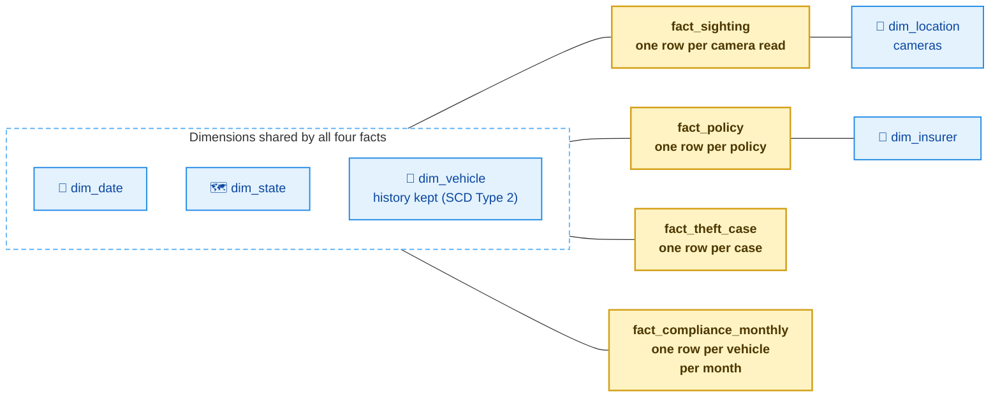

# Data model

How the warehouse is designed: its layers, how each night loads only what changed, the star schema, the cleaning rules and the quality checks. A catalog of the gold tables is at the end.

## 1. Layers

| Layer | Database | What it holds | Each night |
|---|---|---|---|
| Sources | `rto_registration`, `insurance`, `roadcapture`, `theft_records` | The four source systems. Each keeps only its current state | A daily drop is loaded |
| Bronze | `bronze` | Exact copies of new and changed source rows, plus `dwh_batch_id` and `dwh_loaded_at`. Append-only, so every version is kept | Copies the rows past each source's watermark |
| Silver | `silver` | Cleaned and matched rows, still one table per source, plus the `ref/` files as `ref_*` tables | Rebuilt in full from bronze (about 20 seconds) |
| Gold | `gold` | The star schema (5 dimensions, 4 facts) and the `vehicle_360` view | Adds what is new (section 4) |
| Run log | `etl` | Batches, steps, check results and watermarks | One row per run, step and check |

## 2. Loading only what changed

Every run has a business date, `as_of`: the last day it covers. It defaults to yesterday, and it cannot go back before the last successful run. Bronze copies the rows whose change column is newer than the stored watermark (the newest value copied so far) and no later than the end of `as_of`. The copies and the new watermarks are committed together.

| Source table | Change column | Note |
|---|---|---|
| `registrations` | `last_updated` (date) | Runs cover only finished days, so a date is precise enough |
| `policies` | `issued_at` | A policy never changes once issued |
| `theft_shredding` | `updated_at` (date) | Updated when a case is recovered or closed |
| `capture_log` | `ingested_at` | Not `capture_time`: 1% of reads arrive more than a day late and would be skipped |

To replay the simulated nights, load the base files and run with `--as-of 2026-11-03`, then load each daily drop and run with that drop's date.

## 3. Questions the warehouse answers

| # | Question | Answered from |
|---|---|---|
| Q1 | What share of registered vehicles in each state has no valid third-party cover, month by month? | `fact_compliance_monthly` |
| Q2 | How does that compare with the vehicles actually seen on the road? | `fact_compliance_monthly` |
| Q3 | Which toll plazas and city junctions see the most uninsured traffic? | `fact_sighting` |
| Q4 | How many owners renew on time, and how long do lapses last, by vehicle type? | `fact_policy` |
| Q5 | How many vehicles are stolen per state each year, and how many are recovered, how fast? | `fact_theft_case` |
| Q6 | Which insurers issue the most policies by state and vehicle type, with merged companies combined? | `fact_policy` |

## 4. Star schema

| Fact | One row per | Kind | Each night |
|---|---|---|---|
| `fact_sighting` | camera read (adjacent-lane duplicates left out) | transaction | adds the new reads |
| `fact_policy` | policy | transaction | adds new policies, and retries any whose vehicle was not registered yet |
| `fact_theft_case` | theft or scrapping case | accumulating snapshot | rewrites every case (there are few) |
| `fact_compliance_monthly` | vehicle per month, from January 2023 | periodic snapshot | rebuilds the current and previous month; older months are final |

Which dimensions each fact uses, and in what role:

| Fact | `dim_date` | `dim_state` | `dim_location` | `dim_vehicle` | `dim_insurer` |
|---|---|---|---|---|---|
| `fact_sighting` | capture date | camera's state | camera | vehicle seen | |
| `fact_policy` | issued, valid from, valid to | registration state | | vehicle insured | insurer |
| `fact_theft_case` | reported, recovered | where the case was filed | | vehicle | |
| `fact_compliance_monthly` | month | registration state | | vehicle | |

## 5. Keys and history

- **Surrogate keys.** Each dimension has an integer key (`vehicle_key`, `state_key`, ...). Date keys are `YYYYMMDD` integers. Facts store these keys, not plates or names.
- **Unknown rows.** Every dimension has a row with key `-1` ("Unknown" or "Not yet"), so a fact key is never NULL and joins never drop rows. It is `-1` rather than `0` because MySQL treats an inserted `0` in an `AUTO_INCREMENT` column as "use the next id".
- **Vehicle history (SCD Type 2).** Each registry change (an ownership transfer, a renewal, a scrapping) adds a new row to `dim_vehicle`, identified by `chassis_no` plus the registry's `last_updated`. `valid_from` and `valid_to` bound each version; the current one has `valid_to = 9999-12-31` and `is_current = 1`. A vehicle's first version starts on `1900-01-01`, so events from before the warehouse existed still find it.
- **Point in time.** Each fact points at the vehicle version that was valid on the fact's own date.
- **History starts with the warehouse.** The registry keeps only the current row, so changes from before the first load cannot be recovered.
- **No enforced foreign keys** in gold; the quality checks verify that every key resolves.

## 6. Cleaning rules (silver)

1. **One plate format.** Uppercase, drop spaces and hyphens, then parse as standard (`MH-4-AB-1234` → `MH04AB1234`), Delhi (`DL-06-SCP-2349` → `DL6SCP2349`) or BH series (`22 BH 1234 AA` → `22BH1234AA`). Anything else is `INVALID_FORMAT`.
2. **A vehicle is its chassis number.** Every policy carries it, including those filed under `NEW`. Theft cases without one get it from the registry, through the plate. Camera reads are matched through the plate to the registry.
3. **Third-party cover.** Every policy type includes it except `Standalone OD`.
4. **Insurer names** map through `ref/insurers.csv` (Bharti AXA → ICICI Lombard, Reliance General → IndusInd General Insurance).
5. **Camera reads.** A second read of the same plate by the same camera within 5 seconds is a duplicate: flagged in silver, left out of gold. Each read gets a status: `MATCHED`, `INVALID_FORMAT`, `NOT_IN_REGISTRY` or `UNREADABLE`.
6. **Scrapping** counts from the scrapping certificate's date, or else from the day the registry recorded it.
7. **Theft** counts from the report date up to, but not including, the recovery date.
8. **Status on a date** is one rule, used by every fact. The first match wins:

| Status | When |
|---|---|
| `STOLEN` | a theft case is open on that date |
| `SCRAPPED` | scrapped on or before that date |
| `INSURED` | a policy with third-party cover covers that date |
| `EXPIRED` | the vehicle had third-party cover in the feed, but it has ended |
| `NO_POLICY` | no third-party cover in the feed (which starts on 1 Jan 2023) |

`EXPIRED` and `NO_POLICY` count as uninsured.

## 7. Nightly order

1. Open a batch in `etl.batch`. A MySQL named lock allows one run at a time, and a batch left `RUNNING` by a run that died is marked `FAILED`.
2. **Bronze:** copy the four sources past their watermarks, in one transaction.
3. **Silver:** rebuild every table from bronze. Registrations come first, so today's new vehicles match today's camera reads.
4. **Silver checks.** An ERROR stops the night here, before gold changes.
5. **Gold:** dimensions, then facts, each step in its own transaction. Gold adds only what it doesn't have yet, so a failed night can simply be run again.
6. **Gold checks,** then the batch is closed as `SUCCESS` or `FAILED`.

`scripts/run_nightly.sh` runs these steps every night at 00:05, for yesterday. A missed night needs no special handling: the next run copies everything since the watermarks.

## 8. Quality checks

Each check counts the rows that break a rule, and its result is logged in `etl.step_log`. After silver, an ERROR check is a gate: the night stops before gold changes. After gold, a failed ERROR check marks the batch `FAILED`. A WARN is logged and the night carries on.

| After | Level | Checks |
|---|---|---|
| silver | ERROR | one current version per vehicle; no two vehicles share a plate; every registry plate parses; every vehicle class is mapped; cover ends on or after it starts; no camera read arrives before it was taken; bronze and silver hold the same reads; at least 90% of new reads match a vehicle |
| silver | WARN | every insurer is mapped; every theft case is tied to a vehicle; every camera is in `ref/` |
| gold | ERROR | one current version per vehicle; vehicle versions leave no gaps or overlaps; every fact key finds its dimension row (one check per fact); one gold row per silver read, policy and case; a snapshot row for every registered vehicle this month |
| gold | WARN | policies still waiting for their vehicle; uninsured share within 5 points of last month |

## 9. Design choices

- The monthly snapshot starts in January 2023, when the insurer feed starts; earlier months would show every vehicle as `NO_POLICY`.
- A month's status is taken on its last day. "Uninsured on any day of the month" would count more vehicles.
- Camera misreads are not repaired (for example by swapping `O` and `0`), to keep silver simple.
- Owner names stay in `dim_vehicle` only for the `vehicle_360` view. Drop them if the warehouse should hold no personal data.

## 10. Naming conventions

- One MySQL database per layer: `bronze`, `silver`, `gold`, `etl`. Names are lowercase `snake_case` and avoid MySQL reserved words (`reads` caused one bug).
- Bronze and silver tables keep the source table's name; reference tables are `ref_<file>`.
- Gold tables are `dim_<entity>` and `fact_<process>`.
- Keys end in `_key` (`report_date_key`), flags start with `is_` or `has_`, technical columns start with `dwh_`, and code values are uppercase (`INSURED`, `TOLL_ANPR`).

## 11. Gold tables

| Table | One row per | Columns |
|---|---|---|
| `dim_date` | day, 2008–2035 | `date_key` (`YYYYMMDD`), `full_date`, `year`, `quarter`, `month`, `month_name`, `month_label` (`2026-11`), `fiscal_year` (April–March: `FY2026-27`), `day_of_week` (1 = Monday), `is_weekend` |
| `dim_state` | state or union territory (36) | `state_key`, `state_code` (`TS`, `OD`, ...), `state_name` |
| `dim_location` | camera (1,307) | `location_key`, `camera_id`, `camera_type` (`TOLL_ANPR` or `CITY_ANPR`), `place_name`, `city`, `state_name`, `latitude`, `longitude`, `traffic_per_day` (NHAI's figure, toll plazas only) |
| `dim_insurer` | insurer name (26) | `insurer_key`, `insurer_name` (as on the policy), `current_company`, `sector` (`Public` or `Private`) |
| `dim_vehicle` | version of a vehicle (100,010) | `vehicle_key`, `chassis_no`, `plate`, `vehicle_group`, `vehicle_class`, `body_type`, `maker`, `make_model`, `fuel_type`, `colour`, `transport_category`, `registration_date`, `rto_code`, `rto_name`, `state_name`, `owner_type`, `owner_name`, `owner_serial`, `reg_status`, `reg_valid_upto`, `last_updated`, `valid_from`, `valid_to`, `is_current`, `dwh_batch_id` |
| `fact_sighting` | camera read | `capture_id`, `date_key`, `capture_time`, `vehicle_key`, `location_key`, `state_key` (camera's state), `plate_read`, `read_status`, `status_at_sighting`, `is_uninsured`, `camera_vehicle_type`, `ocr_confidence`, `ingested_at`, `dwh_batch_id` |
| `fact_policy` | policy | `policy_id`, `policy_number`, `vehicle_key`, `insurer_key`, `state_key` (registration state), `issued_date_key`, `valid_from_date_key`, `valid_to_date_key`, `policy_type`, `has_tp_cover`, `cover_days`, `renewal_gap_days`, `filed_under_new`, `dwh_batch_id` |
| `fact_theft_case` | theft or scrapping case | `case_id`, `reference_no`, `case_type` (`STOLEN` or `SCRAPPED`), `case_status`, `vehicle_key`, `state_key`, `report_date_key`, `recovery_date_key` (`-1` until recovered), `days_to_recovery`, `sightings_after_report`, `dwh_batch_id` |
| `fact_compliance_monthly` | vehicle per month | `month_key`, `vehicle_key`, `state_key` (registration state), `status_as_of`, `status`, `is_uninsured`, `days_since_cover_ended`, `vehicle_age_years`, `sightings_in_month`, `dwh_batch_id` |

A few columns need a word:

- `status_at_sighting` and `status` follow rule 8 on the fact's own date. A sighting is `UNKNOWN` when the read matched no vehicle; `STOLEN` at a sighting means a stolen vehicle on the road, and `SCRAPPED` a cloned plate.
- `renewal_gap_days`: days without third-party cover before this policy started (0 = renewed on time). It is NULL for a vehicle's first policy in the feed and for `Standalone OD`.
- `sightings_after_report`: camera reads of the vehicle after the report date (up to recovery, for thefts).
- `status_as_of`: the month's last day, or the run's `as_of` for the current month.

The `vehicle_360` view has one row per vehicle seen on camera: its registry details, its latest policy with third-party cover, where and when it was last seen, and its status on the latest `as_of`.

Not built yet: summary views (marts) for the six questions above, and a dashboard.
